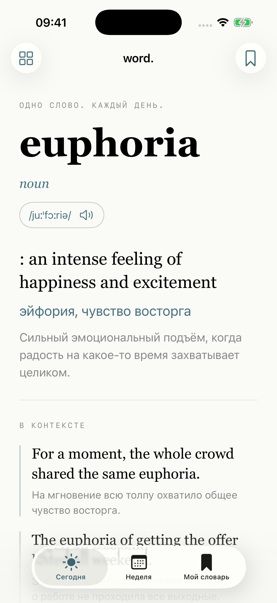
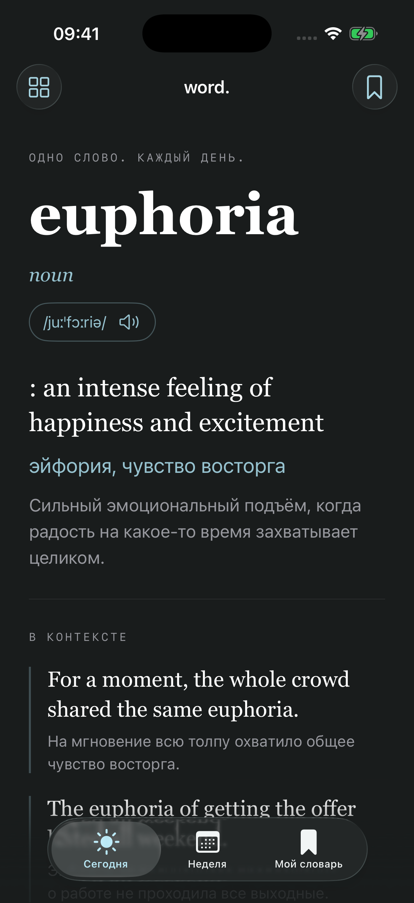
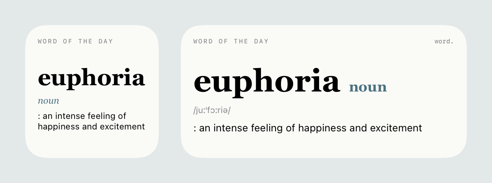
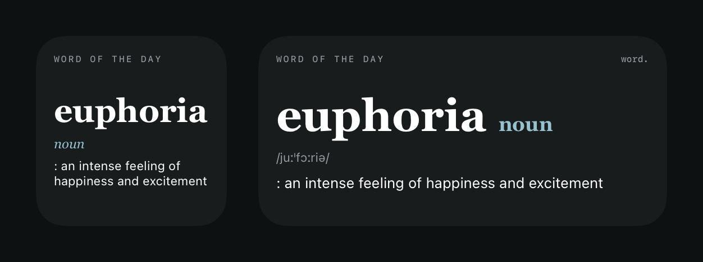

# word. — одно английское слово каждый день

Небольшое приложение для iPhone: новое слово на домашнем экране, перевод и примеры — в одном нажатии. В подборке смешаны повседневный английский, разговорные выражения и сленг.

Визуальное настроение вдохновлено обложкой **euphoria** Kendrick Lamar: крупная словарная типографика, бумажный фон и приглушённый синий. Интерфейс поддерживает светлую и тёмную темы.

<p align="center">
  
  &nbsp;&nbsp;
  
</p>

<p align="center"><em>Скриншоты приложения в iPhone Simulator, iOS 26.3.</em></p>

## Что внутри

- **Слово дня в виджете.** Маленький и средний размеры; нажатие открывает полную карточку этого слова.
- **Понятный разбор.** Английское определение, русский перевод и пояснение, два примера с переводом, подсказки по употреблению и близкие по смыслу слова.
- **Произношение.** Прослушивание слова через системный синтез речи iOS.
- **Последняя неделя.** Сегодня и шесть предыдущих дней — можно вернуться к пропущенным карточкам.
- **Мой словарь.** Закладка справа вверху сохраняет слово; избранное доступно между запусками приложения.
- **1000 карточек офлайн.** Без регистрации, сервера, рекламы и ключей API. Запас будущих слов виден в разделе «Виджет».

<p align="center">
  
  <br>
  
</p>

<p align="center"><em>Рендеры из SwiftUI-кода виджета. Фон и скругления добавлены для демонстрации; оформление на домашнем экране зависит от iOS.</em></p>

## Установка на iPhone

Требуется **iPhone с iOS 17 или новее**. Есть два способа: установить готовый `.ipa` через свой компьютер или собрать приложение из исходников в Xcode.

### Из готового .ipa — Windows или Mac

Этот вариант не требует Xcode и платной подписки Apple Developer. Понадобятся свой компьютер, кабель для первого подключения и бесплатный Apple Account.

1. Открой [Releases](https://github.com/Timokrut/word-of-day/releases) и скачай `.ipa` из **Assets**, если сборка приложена к релизу. Если файла нет, используй сборку из исходников ниже. Кнопка GitHub **Source code (zip)** скачивает исходники, установить этот ZIP на iPhone нельзя.
2. Установи [Sideloadly с официального сайта](https://sideloadly.io/) на свой Windows или Mac. Для Windows выполни требования установщика к iTunes и iCloud, указанные на сайте.
3. Подключи iPhone к своему компьютеру кабелем, разблокируй его и подтверди доверие компьютеру.
4. Открой Sideloadly, выбери iPhone, перетащи `.ipa` в окно и укажи **свой Apple Account** для подписи. **Не включай удаление App Extensions / PlugIns**: это удалит виджет из устанавливаемого приложения.
5. Запусти установку. Если iOS попросит, подтверди доверие профилю разработчика в **Настройки → Основные → VPN и управление устройством**. Включи **Режим разработчика** в **Настройки → Конфиденциальность и безопасность** и выполни предложенную перезагрузку.
6. Открой **word.** на телефоне, затем добавь виджет по инструкции ниже.

**Бесплатная подпись действует 7 дней.** До истечения срока её нужно обновить, иначе приложение перестанет запускаться. Sideloadly поддерживает автоматическое обновление подписи: компьютер должен работать, а iPhone быть доступен по кабелю или настроенному Wi-Fi-подключению в той же сети. После первого подключения можно включить синхронизацию по Wi-Fi; на Mac — в Finder. Ограничения описаны у [Apple](https://developer.apple.com/help/account/basics/about-your-developer-account) и в [Sideloadly](https://sideloadly.io/).

Этот способ установки поддерживается Sideloadly; конкретная сборка word. с виджетом через него пока не проверена. Сам по себе `.ipa` из браузера не устанавливается как Android APK.

### Из исходников — Mac и Xcode

Сборка проекта проверена в **Xcode 26.3**. Полный Xcode включает iOS SDK; отдельно устанавливать SDK не нужно. Если App Store предлагает неподходящую для macOS версию, Xcode можно скачать из [Apple Developer Downloads](https://developer.apple.com/download/all/). Совместимость версий: [таблица Apple](https://developer.apple.com/support/xcode/).

```sh
git clone https://github.com/Timokrut/word-of-day.git
cd word-of-day
open WordDaily.xcodeproj
```

1. В Xcode открой **Settings → Accounts** и добавь свой Apple Account.
2. В настройках проекта выбери target **WordDaily**, затем **Signing & Capabilities**: включи **Automatically manage signing** и выбери свой **Team**. Бесплатный **Personal Team** подходит для установки на своё устройство.
3. Повтори настройку для target **WordDailyWidget**. В обоих targets замени идентификаторы автора на свои уникальные. Например:

   | Target | Bundle Identifier |
   | --- | --- |
   | WordDaily | `com.yourname.wordofday` |
   | WordDailyWidget | `com.yourname.wordofday.widget` |

   Идентификатор расширения должен начинаться с идентификатора приложения. Выбери свой Team для конфигурации сборки, которую запускаешь.

4. Подключи разблокированный iPhone, подтверди доверие компьютеру и включи **Режим разработчика**, если Xcode или iOS этого потребует.
5. В верхней панели выбери схему **WordDaily** и свой iPhone как устройство запуска. Нажми **Run** (`⌘R`). При необходимости подтверди доверие профилю в настройках iPhone.
6. После первого запуска добавь виджет.

Ошибка **Signing requires a development team** означает, что Team не выбран у одного из двух targets. При **No profiles were found** проверь свой Team, автоматическую подпись и уникальные Bundle Identifier у приложения и расширения. Для Personal Team также действует ограничение подписи в 7 дней — затем приложение нужно подписать и установить повторно.

Для знакомства без телефона выбери iPhone Simulator вместо устройства и нажми `⌘R`: подпись разработчика не нужна. Если симулятора нет, установи iOS runtime через настройки компонентов Xcode.

### Добавление виджета

1. Запусти приложение хотя бы один раз.
2. На домашнем экране iPhone удерживай свободное место, затем выбери **Изменить → Добавить виджет** (на некоторых версиях iOS — кнопка **+**).
3. Найди **word.**, выбери маленький или средний размер и нажми **Добавить виджет**.
4. Нажми на виджет, чтобы открыть перевод и примеры. Закладка справа вверху карточки сохраняет слово в **«Мой словарь»**.

Инструкция также доступна по кнопке слева вверху экрана **«Сегодня»**. Виджет нельзя разместить автоматически; момент ежедневного обновления контролирует iOS.

## Как выбирается слово

В `Shared/words.json` находятся **1000 карточек с разными словами и устойчивыми выражениями**: 893 стандартных, 55 разговорных и 52 сленговых. У каждой есть часть речи, транскрипция, английское определение, русский перевод и пояснение, заметка об употреблении и два разных примера с переводом. Поле `synonyms` содержит близкие по смыслу слова, когда они есть; для слов без подходящего синонима оно пустое.

Каждая местная календарная дата получает фиксированный индекс в подборке: 13 ноября 2026 года — euphoria, 14 ноября — lowkey. **Последнее слово выйдет 8 августа 2029 года; с 9 августа новых слов нет. Циклического повтора нет.**

На экране «Виджет» показано количество ещё не опубликованных слов. После выхода первой карточки остаётся 999, на следующий день — 998. Дни считаются по местному календарю, даже если приложение не открывали. После последней карточки приложение и виджет сообщают о завершении подборки.

Карточки не удаляются из JSON: уменьшается очередь будущих слов. Это сохраняет историю и рабочие ссылки. История показывает реально опубликованные слова за последние семь дат, от новых к старым. До начала подборки и после её завершения вымышленные слова не добавляются. «Мой словарь» хранится отдельно в UserDefaults как JSON полных карточек; сохранённые слова остаются доступными после завершения подборки. Удаление приложения удалит локальный словарь.

Виджет заранее получает timeline на семь следующих полуночей, поэтому ему не нужен интернет для смены слова. Переходы на летнее/зимнее время учитываются через Calendar. iOS управляет фактическим моментом обновления; точная полночь не гарантируется. При возвращении приложения на передний план запрашивается обновление timeline, в том числе после смены часового пояса.

Для расширения подборки добавляйте карточки в конец массива. Перестановка уже существующих карточек изменит их соответствие датам. Обновите ожидаемый размер в проверках при следующем расширении. Интернет требуется только при открытии внешних ссылок на источники, а не для выхода слова дня.

## Источники и подготовка

Английские определения и часть синонимов взяты из открытого Wordnet, транскрипции — из открытого IPA-словаря, часть двуязычных примеров — из Tatoeba. Русские пояснения, заметки об употреблении, отдельная подборка разговорной лексики и редакционные исправления подготовлены для приложения.

| Источник | Материал в подборке | Лицензия |
| --- | --- | --- |
| [Open English Wordnet 2025](https://en-word.net/downloads) | Определения и часть близких по смыслу слов, с редакционными адаптациями | CC BY 4.0 |
| [Tatoeba](https://tatoeba.org/en/downloads) | Английские примеры и их русские переводы; ссылки на конкретные предложения сохранены рядом с каждым примером | CC BY 2.0 FR |
| [ipa-dict](https://github.com/open-dict-data/ipa-dict) | Большинство транскрипций новых слов | MIT |

Полные сведения и уведомления: [Shared/DataLicenses.txt](Shared/DataLicenses.txt), также доступны из карточки через «Источники и лицензии». Источники и контрольные суммы исходных выгрузок записаны в [Content/bank-manifest.json](Content/bank-manifest.json).

Проверена структура всех карточек, уникальность слов, наличие 2000 пар примеров и русских переводов. Выполнена выборочная контекстная редактура, в том числе замена неподходящих значений и почти одинаковых примеров. Это учебная подборка с открытыми корпусными данными; профессиональная лингвистическая вычитка всех 2000 примеров не проводилась.

## Проверки

`sh Tests/verify.sh` проверяет JSON и запускает Foundation/Combine-проверки без iOS SDK: ровно 1000 уникальных карточек, полный проход всех 1000 календарных дней без повторов, ежедневное уменьшение запаса, исчерпание очереди, четыре часовых пояса, переходы DST, граница года, deep links, история семи дней без будущих дат, сохранение и повторная загрузка словаря, удаление и повреждённые данные. Проверки словаря используют отдельный временный домен UserDefaults и не затрагивают словарь приложения.

Отдельная проверка данных: `python3 Tools/validate_word_bank.py`.

Для проверки сборки без подписи: `DEVELOPER_DIR=/Applications/Xcode.app/Contents/Developer xcrun xcodebuild -project WordDaily.xcodeproj -scheme WordDaily -destination 'generic/platform=iOS' CODE_SIGNING_ALLOWED=NO build`. Перед публикацией нужно проверить оба размера виджета на устройстве, тёмную/тонированную тему, Dynamic Type и произношение. Для ручной проверки новых экранов: открыть день из «Недели», сохранить закладкой, найти его в «Моём словаре», перезапустить приложение и проверить, что слово осталось; затем удалить его и убедиться, что закладка в истории обновилась.

## Структура

- `App/` — SwiftUI-приложение, статья слова, произношение, помощь.
- `Widget/` — WidgetKit provider и оба размера виджета.
- `Shared/` — модели, подборка, календарное расписание, ссылки и визуальные стили.
- `Tests/` — независимые проверки общей логики.
- `Tools/validate_word_bank.py` — проверка полноты и уникальности карточек.
- `Content/` — сведения о подготовке и источниках офлайн-подборки.

Стек: SwiftUI + WidgetKit, без сторонних Swift-пакетов. Карточки и избранное хранятся на устройстве; синхронизация между устройствами и автоматическое пополнение подборки через интернет пока не реализованы.

Первоначальный браузерный макет: [Design/preview.html](Design/preview.html) — скачай репозиторий и открой файл в браузере. Он показывает ранний вариант интерфейса; скриншоты выше относятся к текущему нативному приложению.
